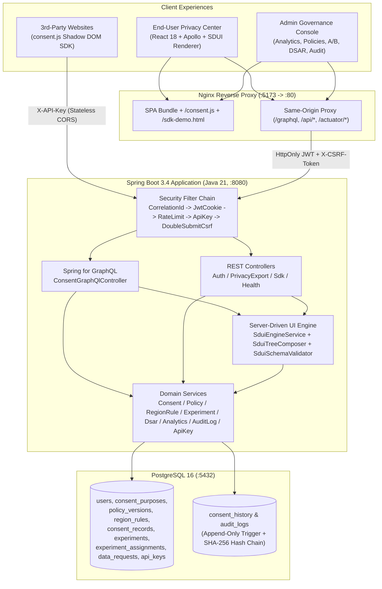
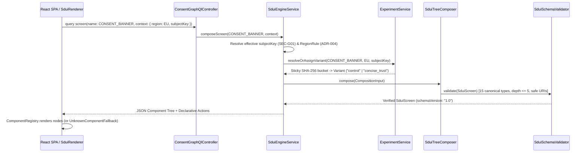

# ConsentHub — System Architecture (`ARCHITECTURE.md`)

ConsentHub is a full-stack **Privacy, Data Rights, and Server-Driven Consent Management Platform** built with **Java 21 + Spring Boot 3.4**, **Spring for GraphQL**, **PostgreSQL 16**, and **React 18 + strict TypeScript**.

---

## 1. Architectural Topology

---

## 2. Server-Driven UI (SDUI) Pipeline

Instead of hardcoding regional legal copy, button layouts, and A/B test branches inside client bundles, ConsentHub computes UI component trees on the server via `Query.screen(name, context)` (and embeds them in `GET /api/v1/sdk/config`).

### Key SDUI Design Properties
1. **Thin, Declarative Client**: [SduiRenderer.tsx](file:///d:/The%20Company/Netflix/frontend/src/sdui/SduiRenderer.tsx) maps canonical `type` names (`BannerShell`, `Card`, `Header`, `PurposeToggleRow`, `ActionBar`, `Button`, `StatGrid`, etc.) to design-system primitives and dispatches declarative server actions (`ACCEPT_ALL`, `REJECT_OPTIONAL`, `SUBMIT_CONSENT`, `TOGGLE_PURPOSE`, `OPEN_PREFERENCES`, `NAVIGATE`).
2. **Compliance Guardrails Cannot Be Overridden by Experiments**: [SduiTreeComposer.java](file:///d:/The%20Company/Netflix/backend/src/main/java/io/consenthub/sdui/SduiTreeComposer.java) enforces that `essential` is always locked (`checked: true, required: true`), `EU` (`OPT_IN`) never pre-checks optional toggles and renders a non-dismissible modal (`dismissible: false`), and symmetric `Reject Optional` / `Do Not Sell or Share` buttons can never be hidden under `GDPR` or `CCPA`.
3. **Dual-Mode Validation & Forward Compatibility**: [SduiSchemaValidator.java](file:///d:/The%20Company/Netflix/backend/src/main/java/io/consenthub/sdui/SduiSchemaValidator.java) enforces strict server-side validation (15 canonical types, max depth `5`, URI scheme allowlist blocking `javascript:`/`data:`), while the React client renders [UnknownComponentFallback.tsx](file:///d:/The%20Company/Netflix/frontend/src/sdui/UnknownComponentFallback.tsx) if a newer server emits an unfamiliar component type.

---

## 3. Sticky A/B Experimentation Engine

To prevent variant flicker across page reloads—even for unauthenticated first-visit visitors—ConsentHub uses deterministic cryptographic bucketing (`ADR-005`):

1. **Subject Key Continuity (`ADR-008`)**: Authenticated users bind to `user:<uuid>`, while visitors generate a local pseudonymous `anon:<id>`. On signup/login, prior `anon:<id>` consent choices seamlessly migrate into `user:<uuid>`.
2. **Hash Bucketing**: [ExperimentService.java](file:///d:/The%20Company/Netflix/backend/src/main/java/io/consenthub/service/ExperimentService.java) computes `SHA-256(experimentId + ":" + subjectKey)` -> unsigned 32-bit big-endian integer `mod 100` (`0..99`) and maps across variant weights summing to `100`.
3. **Sticky Assignment & Conversion Attribution**: Exposure rows are persisted in `experiment_assignments` (`UNIQUE(experiment_id, subject_key)`). Admin preview calls (`previewVariantKey`) render the requested variant in-memory without polluting `experiment_assignments`. Granting any optional purpose marks `converted = true` and updates live per-variant conversion rates.

---

## 4. Security & Privacy Architecture

| Layer | Implementation |
|-------|----------------|
| **Session Transport** | Short-lived `HMAC-SHA256` JWT stored in `ch_access_token` (`HttpOnly; SameSite=Lax; Path=/`), eliminating `localStorage` XSS token theft (`ADR-003`). |
| **CSRF Defense** | Constant-time (`MessageDigest.isEqual`) double-submit verification in [DoubleSubmitCsrfFilter.java](file:///d:/The%20Company/Netflix/backend/src/main/java/io/consenthub/security/DoubleSubmitCsrfFilter.java) comparing cookie `ch_csrf_token` against `X-CSRF-Token` header on all cookie-authenticated mutations. |
| **Password & Key Cryptography** | `BCryptPasswordEncoder(12)` with anti-timing dummy hash verification on unknown/deleted emails; third-party SDK keys stored exclusively as `SHA-256` hex digests in `api_keys`. |
| **Data Minimization** | Client IPs are salted (`IP_HASH_SALT`) and hashed with `SHA-256` in memory before writing `consent_history.ip_hash`; User-Agents are reduced to coarse `Browser / OS` summaries (`Chrome / Windows`). |
| **Tamper-Evident Ledgers** | PostgreSQL `BEFORE UPDATE OR DELETE` trigger `prevent_append_only_mutation()` blocks row mutation/deletion on `consent_history` and `audit_logs`. `AuditLogService` serializes writes via `pg_advisory_xact_lock` and chains `entry_hash = SHA-256(prev_hash | id | actor | action | entity | epoch_ms | canonical_json)`. |
| **DSAR Fulfillment** | `GET /api/v1/privacy/export` streams a `Cache-Control: no-store` GDPR Art. 20 JSON archive. Completing a `DELETE` DSAR scrubs historical `export_payload_json`, revokes optional consents (`SYSTEM_ERASURE`), pseudonymizes `users` PII, and invalidates active JWTs via `deleted_at IS NOT NULL`. |
